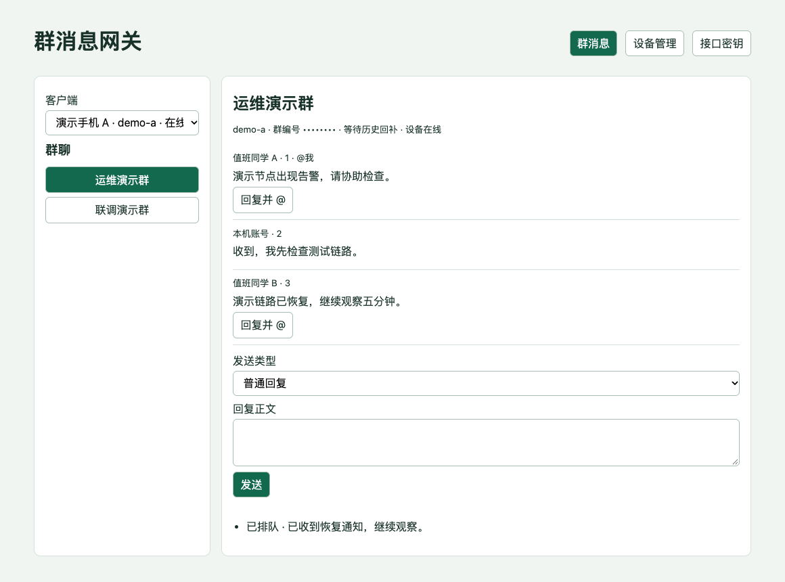
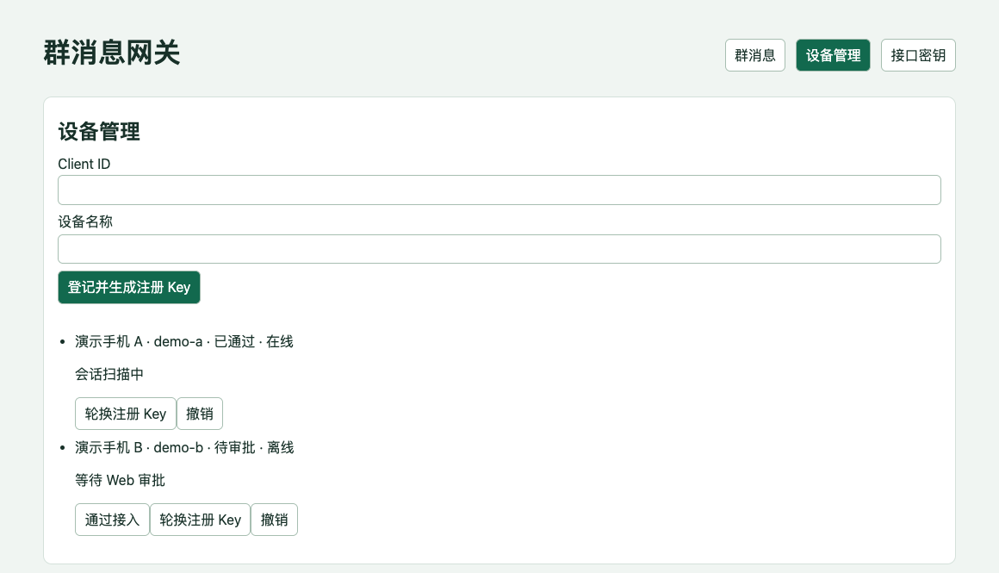
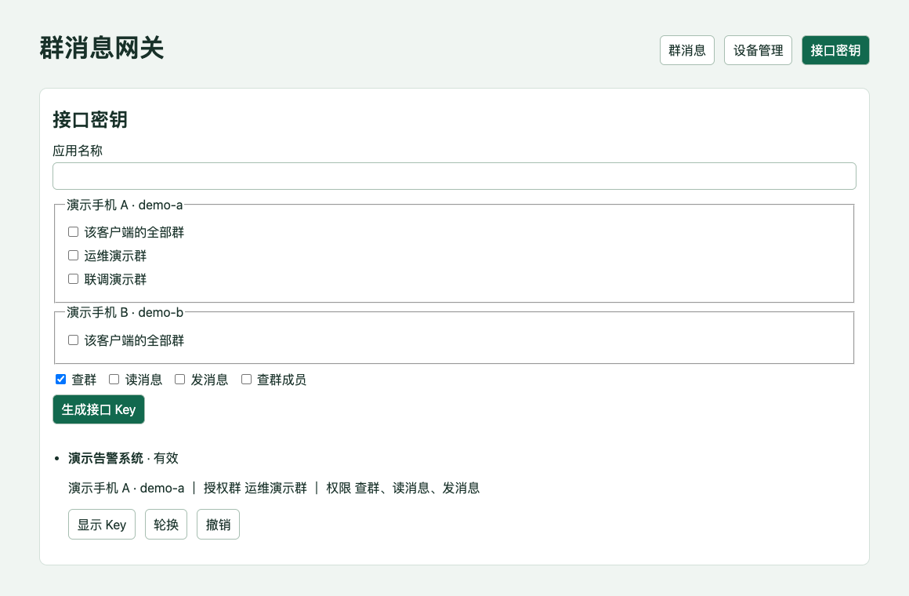

# wx_msg_gateway

**让企业微信值班号 24 小时接收群消息，并为后端接入大模型提供统一的收发接口。**

在一台常驻安卓手机上登录企业微信值班号。客户端定期扫描可定位的群聊，把最新文字消息同步到网关。值班人员可以在网页上查看告警和回复群聊，业务系统也可以通过 API 接入大模型，做告警归类、上下文整理和回复草稿生成。业务侧可按自己的规则将审核后的回复提交给网关，由值班号发回原群。

| 组件 | 职责 |
| --- | --- |
| 安卓客户端 | 通过无障碍服务遍历企微群聊，采集可见文字，执行群回复 |
| Rust 网关 | 管理设备接入审批，按客户端和群编号保存消息，维护发送队列与回执 |
| Web 管理端 | 查看群消息与发送状态，回复并 @ 原发送人，管理设备和接口 Key |
| 第三方 API | 按群读取最近消息或按 offset 增量读取，提交普通回复或结构化告警 |

## 界面预览

截图来自本地演示环境。群名、设备和消息均为示例，群编号已遮挡，密钥保持隐藏。

**群消息与回复**

切换设备和群聊，查看发送人、消息序号和「@我」标记，并在当前群提交回复。



<details>
<summary>设备管理与接口密钥</summary>

**设备管理**

登记手机并生成注册 Key，审批接入后即可开始同步。



**接口密钥**

为业务系统单独生成 Key，按客户端、群聊和操作授权。



</details>

## 支持范围

- 主要客户端为「企微网页收发」。已验证的设备组合为荣耀 10、Android 9、企业微信 5.0.13（versionCode 84802）。APK 最低安装版本为 Android 7.1（API 25）。原生 @ 目前只在 Android 9 启用。
- 读取依赖当前可见的无障碍节点。设备需要亮屏、解锁并保持企微在前台。历史回补可能遇到缺口。群编号和消息编号由网关分配。
- 只在已授权的设备、账号和群内使用。安卓无障碍权限由设备用户开启，设备还需通过网关管理端审批。

## 构建网关

需要支持 Rust 2024 edition 及锁定依赖的 Rust 工具链和 C 编译工具。首次启动用 OpenSSL 生成管理 Key。以下命令从项目根目录运行。

```sh
cargo build --release --locked --manifest-path gateway/rust/Cargo.toml
umask 077
mkdir -p state
if [ ! -e state/gateway.json ]; then
  admin_token=$(openssl rand -hex 32) &&
    printf '{"admin_token":"%s"}\n' "$admin_token" > state/gateway.json
fi
./gateway/rust/target/release/wecom-gateway --config state/gateway.json --host 127.0.0.1
```

打开 `http://127.0.0.1:8765/`，使用本机配置里的 `admin_token` 登录。初次配对时，在「设备管理」登记客户端并生成注册 Key。手机接入端口默认是 `8766`。接入真机时，请参照部署说明配置可从手机访问的地址和 TLS。

Linux x86_64 静态二进制、反向代理、Web 会话和设备接入配置见 [网关部署说明](gateway/README.md)。

## 构建安卓客户端

需要 JDK、Android SDK Platform 35、Build Tools 35.0.0 和 Platform Tools。将 `ANDROID_HOME` 指向自己的 SDK，或使用脚本默认的本机 SDK 路径。

```sh
sh build.sh wecom-web
adb install -r dist/wecom-web-probe.apk
```

打开「企微网页收发」，开启该 App 的无障碍服务并填写网关地址、设备端口、客户端编号和注册 Key。提交接入申请后，在 Web 的「设备管理」通过审批。构建脚本生成本地调试签名，项目不分发签名密钥。

## 接口与测试

- [第三方业务接口](API_SPEC.md#第三方业务接口)
- [安卓和 Web 管理接口](API_SPEC.md)
- [设备执行协议](PROTOCOL.md)

`sh build.sh wecom-web` 同时运行 Android 界面提取、原生 @ 和恢复策略的回归测试。下方的集成测试启动已构建的 Rust 二进制，通过临时数据库和模拟手机验证接口。

```sh
PYTHONDONTWRITEBYTECODE=1 python3 -m unittest discover -s gateway -v
```

## 许可证

项目源码采用 [MIT 许可证](LICENSE)。第三方依赖沿用各自的许可证。
